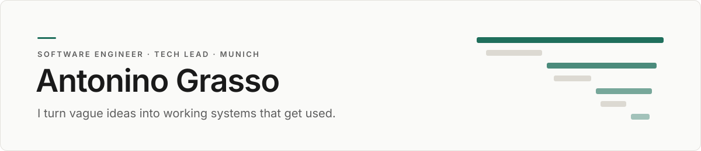

  <picture>
    <source media="(prefers-color-scheme: dark)" srcset="assets/header-dark.svg">
    
  </picture>

I'm a software engineer and technical lead in Munich. My day job is leading KUKA's global AI use case team at Device Insight, where I build AI systems for KUKA's businesses, from the first solution sketch to production. Before that I worked on intent-based robotics R&D, cloud SaaS on AWS and IoT platforms.

Outside work I build tools for working with coding agents: how they get context, and how they get held to a repository's standards.

### Building in the open

- [**agent-docs-standard**](https://github.com/a-grasso/agent-docs-standard): an AGENTS.md profile that gives coding agents the right context where they need it, and nothing stale.
- [**reflock**](https://github.com/a-grasso/reflock): a lockfile for cross-references. It flags a doc whose link still works but whose target has changed underneath it.
- [**turnstile**](https://github.com/a-grasso/turnstile): makes a repository's own checks impossible to forget. A push, or an agent's turn, can't finish while they're red.
- [**portbook**](https://github.com/a-grasso/portbook): finds the dev servers running on your machine and tells you which is which.
- [**hexarch**](https://github.com/a-grasso/hexarch): a small YAML DSL for hexagonal architecture, rendered to an interactive diagram.

With Nicolas Bissig at [Bissig & Grasso](https://bissig-grasso.de/) I build **Cauzar**, observability on OpenTelemetry that finds what changed before anyone asks, and [**kaibo**](https://bissig-grasso.de/en/kaibo/), engineering doctrine your coding agents load before they start the work.

### Latest releases

<!-- releases:start -->
- [**turnstile**](https://github.com/a-grasso/turnstile) [`v0.2.0`](https://github.com/a-grasso/turnstile/releases/tag/v0.2.0) · Oct 20, 2026
- [**reflock**](https://github.com/a-grasso/reflock) [`v0.5.0`](https://github.com/a-grasso/reflock/releases/tag/v0.5.0) · Sep 24, 2026
- [**cursorwrap**](https://github.com/a-grasso/cursorwrap) [`v0.2.2`](https://github.com/a-grasso/cursorwrap/releases/tag/v0.2.2) · Sep 8, 2026
- [**portbook**](https://github.com/a-grasso/portbook) [`v0.2.4`](https://github.com/a-grasso/portbook/releases/tag/v0.2.4) · Jul 31, 2026
- [**hexarch**](https://github.com/a-grasso/hexarch) [`v0.1.1`](https://github.com/a-grasso/hexarch/releases/tag/v0.1.1) · Jul 20, 2026
<!-- releases:end -->

**Mostly in** Kotlin, Python, Rust and Go, on AWS and Azure. CV, the full portfolio and write-ups at [a-grasso.dev](https://a-grasso.dev).

<picture>
  <source media="(prefers-color-scheme: dark)" srcset="https://raw.githubusercontent.com/a-grasso/a-grasso/output/snake-dark.svg">
  
</picture>
